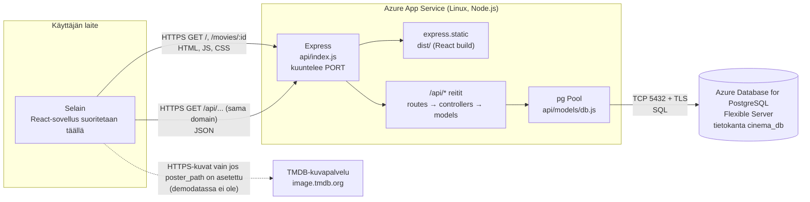
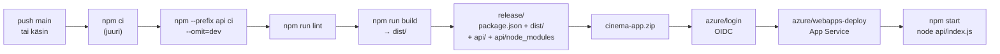
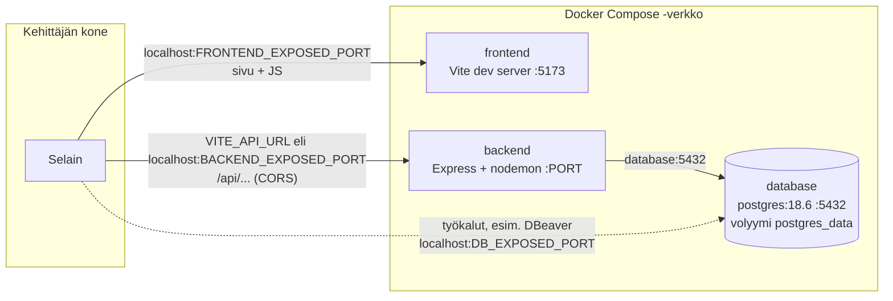
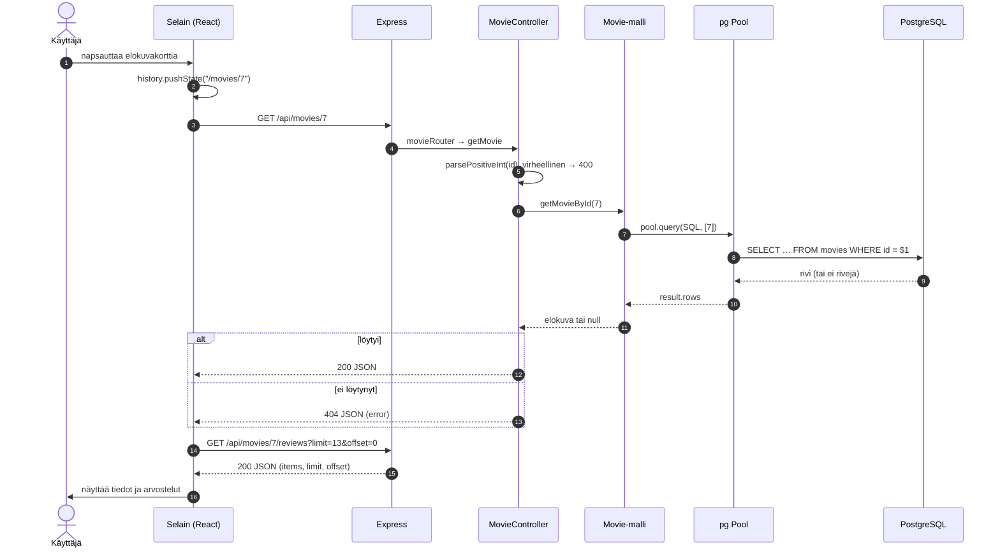

# Arkkitehtuuri

**Analysoitu commit:** `e75678029267515888ea39b5e557dcfcac5db933`. Kaaviot kuvaavat koodin ja workflow-tiedoston mukaista toteutusta. Azure-asetuksia (App Settings, palomuuri, Health check) ei ole tarkistettu tästä repositoriosta.

## 1. Tuotanto (Azure)

**Missä mikäkin suoritetaan:**
- React-koodi käännetään GitHub Actionsissa (`npm run build`) staattisiksi tiedostoiksi `dist/`-kansioon. Selain lataa ne Expressiltä ja **suorittaa Reactin käyttäjän laitteessa**.
- Express ([api/index.js](../api/index.js)) palvelee samassa prosessissa sekä API:a (`/api/...`) että `dist/`-tiedostoja (`express.static`). Jos polku ei ole `/api/...` ja selain pyytää HTML:ää, Express palauttaa `dist/index.html` (esim. `/movies/7` suoralla linkillä), ja React päättää näytettävän sivun.
- Express ottaa yhteyden tietokantaan `pg.Pool`-olion kautta. Selain ei koskaan ota yhteyttä tietokantaan.

**TMDB:** palvelimella ei ole TMDB-integraatiota (ei API-avainta eikä kutsuja `api.themoviedb.org`:iin). Frontend muodostaa vain kuvan osoitteen `https://image.tmdb.org/t/p/w500` + `poster_path` ja linkin TMDB:n sivulle. Seuraava vaihe on TMDB-haku palvelimella (avain App Settingsiin, ei `VITE_*`-muuttujaan).

### Sama domain ja `VITE_API_URL`
[src/App.jsx](../src/App.jsx): `baseURL` on tuotannossa `""`, joten pyynnöt menevät samaan osoitteeseen (`/api/movies`). Silloin CORSia ei tarvita, eikä Azure-osoitetta kirjoiteta koodiin. Kehityksessä (`npm run dev`, Docker) `baseURL` on `VITE_API_URL`, oletuksena `http://localhost:3000`. `VITE_*`-arvot leivotaan JavaScript-pakettiin buildin aikana, joten niihin **ei saa laittaa salaisuuksia**.

### `PORT`
App Service ohjaa liikenteen sovellukselle ja kertoo portin ympäristömuuttujassa `PORT`. Express kuuntelee `Number(process.env.PORT || 3000)` osoitteessa `0.0.0.0`. HTTPS päättyy App Servicen etupäähän; sovellus itse kuuntelee HTTP:tä sisäverkossa.

### `/api/health`
Ajaa `SELECT 1`: 200 `healthy/connected` tai 503 `unhealthy/disconnected`. Docker Compose käyttää sitä backendin healthcheckinä. Azuressa sitä voi käyttää App Servicen Health checkinä; käyttöönottoa ei ole tarkistettu.

### Tietokantayhteys: TLS ja verkko
- `DB_SSL=true` → `ssl: { rejectUnauthorized: true }`: yhteys salataan ja palvelimen varmenne tarkistetaan.
- Verkkoyhteys edellyttää, että PostgreSQL-palvelimen palomuuri sallii App Servicen (esim. "Allow public access from Azure services" tai Web Appin lähtevät IP-osoitteet). Asetusta ei näy koodissa.
- Web App (Sweden Central) ja tietokanta (North Europe) ovat eri alueilla, mikä lisää viivettä.

## 2. Asetukset ja salaisuudet

| Missä | Mitä | Huom. |
| --- | --- | --- |
| Azure App Service → Environment variables (App Settings) | `DB_HOST`, `DB_PORT`, `DB_NAME`, `DB_USER`, `DB_PASSWORD`, `DB_SSL`, `NODE_ENV` | Näkyvät sovellukselle ympäristömuuttujina. Arvoja ei ole repositoriossa. |
| GitHub → Secrets | `AZURE_CLIENT_ID`, `AZURE_TENANT_ID`, `AZURE_SUBSCRIPTION_ID` | Tunnisteita OIDC-kirjautumiseen, eivät salasanoja. |
| Paikallinen `.env` (gitignore) | kehityksen ja Dockerin arvot | Malli: [.env.example](../.env.example) |
| Koodi | ei salaisuuksia | `.env` jätetään pois myös julkaisupaketista (`rsync --exclude`) |

## 3. Kaksi eri tunnistautumista

| | Julkaisu (GitHub → Azure) | Sovellus → PostgreSQL |
| --- | --- | --- |
| Kuka | GitHub Actions -ajo | Express-prosessi App Servicessä |
| Miten | **OIDC**: workflow (`id-token: write`) saa GitHubilta lyhytikäisen tokenin, ja `azure/login` vaihtaa sen Entra ID:ssä Azure-tunnukseen. Luottamus perustuu federoituun tunnistetietoon (app registration tai user-assigned **managed identity**). Pysyvää salasanaa ei tallenneta GitHubiin. | PostgreSQL-käyttäjätunnus ja salasana App Settingsistä (`DB_USER`, `DB_PASSWORD`) TLS-yhteyden yli. |
| Oikeudet | julkaista Web Appiin | lukea ja kirjoittaa `cinema_db`:hen |

Managed identityä ei nyt käytetä tietokantayhteyteen. Microsoft Entra -kirjautuminen PostgreSQL:ään olisi mahdollinen myöhempi parannus, jolloin `DB_PASSWORD` ei olisi tarpeen. Kumpi federoitu identiteetti on käytössä, ei näy repositoriosta.

## 4. GitHub Actions → Azure

- Laukaisu: push `main`iin, paitsi jos muuttuu vain `docs/**`, `.obsidian/**` tai `*.md` (Obsidianin "vault backup" -commitit eivät julkaise), tai käsin (`workflow_dispatch`).
- **Miksi `dist/` ja `api/node_modules` ovat paketissa:** `npm start` ajaa `node api/index.js`. Expressin, `pg`:n, `cors`:n ja `dotenv`:n riippuvuudet on määritelty vain [api/package.json](../api/package.json):ssa, eivät juuren `package.json`:ssa. Jos Azure asentaisi riippuvuudet itse juuresta, palvelin ei käynnistyisi (`Cannot find module 'express'`). `dist/` on käännetty frontend; Azuressa ei ajeta Vitea.
- Workflow tarkistaa ennen pakkaamista, että `dist/index.html`, `api/index.js`, `express` ja `pg` ovat mukana.
- **Migraatioita ei ajeta workflowssa.** Ne ajetaan käsin ja tarkoituksella ([tietokanta.md, luku 5](tietokanta.md)): `npm run db:migrate -- --confirm=cinema_db`. Syy: skeemamuutos tehdään vain tarkistettuna, eikä julkaisu saa muuttaa tietokantaa vahingossa.

## 5. Paikallinen kehitys (Docker Compose)

- **Kontin sisäinen portti ja julkaistu portti** ovat eri asia: `"${BACKEND_EXPOSED_PORT}:${PORT}"` tarkoittaa *isännän portti : kontin portti*. Kontit puhuvat keskenään palvelun nimellä ja sisäisellä portilla (`database:5432`). Selain ja DBeaver käyttävät isännän portteja.
- Selain hakee sivun Vitesta (5173) ja kutsuu API:a eri porttiin (3000), joten kyse on eri alkuperästä; siksi backendissä on `cors()`.
- `init.sql` ajetaan vain, kun volyymi luodaan ensimmäistä kertaa. Sovellustaulut tulevat migraatioista: `docker compose exec backend npm run db:migrate`.
- Lähdekoodi on liitetty kontteihin (bind mount), ja muutokset näkyvät heti (nodemon, Vite HMR).

## 6. Elokuvasivun avaaminen

Jos SQL-kysely epäonnistuu, controller kutsuu `next(error)`, ja [errorHandler](../api/middleware/errorHandler.js) muuttaa virheen HTTP-vastaukseksi (400/409/500). Luettelosivu toimii samoin: `GET /api/genres` ja `GET /api/movies?...` (haku, genre, järjestys ja sivutus URL-parametreina).

## 7. Mitä kaavioissa ei ole

- **TMDB API** (haku, suositut, julisteet): ei toteutettu.
- **Kirjautuminen** (JWT, salasanojen tiivistys): ei toteutettu.
- **Kirjoittavat operaatiot** (arvostelut, listat, ryhmät): tietokannassa on taulut, mutta API:ssa ei ole reittejä.
