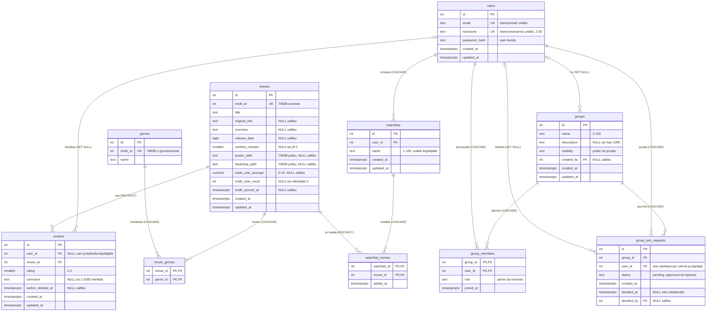

# ERD – tietokannan rakenne

**Lähde:** migraatiot [001_users_movies_reviews.sql](../api/db/migrations/001_users_movies_reviews.sql), [002_watchlists_groups.sql](../api/db/migrations/002_watchlists_groups.sql) [003_group_admin_concurrency.sql](../api/db/migrations/003_group_admin_concurrency.sql) ja [004_private_group_requests.sql](../api/db/migrations/004_private_group_requests.sql) (päivitetty 25.11.2026, haara `feature/group-requests`). Migraatio 003 muuttaa vain triggereitä; 004 lisää taulun `group_join_requests` ja yksityisen ryhmän nimen yksilöllisyyden.

> Kaavio on piirretty **lähdekoodin perusteella**. Azuren `cinema_db`:tä ei ole tarkistettu: ei tiedetä, onko migraatiot ajettu siellä. Rakenne on tarkistettu ajamalla migraatiot väliaikaiseen paikalliseen PostgreSQL 18.6 -kantaan.

Kaaviossa on vain nykyinen toteutus. Suunnitellut taulut (ryhmäviestit, kutsut, jaetut listat, teatterit) puuttuvat tarkoituksella.

## Kaavio

Merkinnät: `||` = täsmälleen yksi, `|o` = nolla tai yksi (viiteavain voi olla `NULL`), `o{` = nolla tai useampi. Suluissa on poistosääntö: mitä lapsiriville tapahtuu, kun vanhempi poistetaan.

Kaikki pääavaimet ovat `INTEGER GENERATED ALWAYS AS IDENTITY`, paitsi liitostaulujen yhdistelmäavaimet. Kaikki sarakkeet ovat `NOT NULL`, ellei kaaviossa lue "NULL sallittu".

## Monesta moneen

| Suhde | Liitostaulu | Avain |
| --- | --- | --- |
| elokuva ↔ genre | `movie_genres` | `(movie_id, genre_id)` |
| toivelista ↔ elokuva | `watchlist_movies` | `(watchlist_id, movie_id)` – sama elokuva vain kerran listalla |
| käyttäjä ↔ ryhmä | `group_members` (+ `role`, `joined_at`) | `(group_id, user_id)` – käyttäjä vain kerran ryhmässä |

## Mitä kaavio ei näytä

### Yksilöllisyys ilman kirjainkokoa
- `users_email_lower_uq` ja `users_nickname_lower_uq` ovat lauseke-indeksejä `lower(email)` ja `lower(nickname)`: `Anna@x.fi` ja `anna@X.fi` ovat sama osoite.
- `watchlists_user_name_uq` = `(user_id, lower(name))`: saman käyttäjän listoilla eri nimet, eri käyttäjillä sama nimi on sallittu.
- `movies.tmdb_id` ja `genres.tmdb_id` ovat tavallisia `UNIQUE`-rajoitteita.

### Kaksi eri arvosanaa
| Arvo | Missä | Asteikko | Lähde |
| --- | --- | --- | --- |
| Oma arvostelu | `reviews.rating` | kokonaisluku **1–5** (CHECK) | sivuston käyttäjät |
| TMDB-keskiarvo | `movies.tmdb_vote_average` | **0–10**, yksi desimaali (`NUMERIC(3,1)`) | TMDB, tallennetaan välimuistiin |

Sivusto näyttää toistaiseksi TMDB-keskiarvon. Omista arvosteluista ei lasketa keskiarvoa. Demodatassa TMDB-arvot ovat `NULL`, koska TMDB-integraatiota ei vielä ole.

### Poistosäännöt

| Poistetaan | `CASCADE` | `SET NULL` | `RESTRICT` (estää poiston) |
| --- | --- | --- | --- |
| `users` | `watchlists` (→ `watchlist_movies`), `group_members` | `reviews.user_id`, `groups.created_by` | – |
| `movies` | `movie_genres` | – | `reviews`, `watchlist_movies` |
| `genres` | `movie_genres` | – | – |
| `watchlists` | `watchlist_movies` | – | – |
| `groups` | `group_members` | – | – |

`RESTRICT`-virheen SQLSTATE PostgreSQL 18:ssa on `23001` (ei `23503`); API palauttaa siitä 409.

### Arvostelut käyttäjän poiston jälkeen
1. `BEFORE DELETE` -trigger `users_anonymize_reviews` asettaa käyttäjän arvosteluihin `comment = NULL` ja `author_deleted_at = now()`.
2. Viiteavain asettaa `user_id = NULL` (`ON DELETE SET NULL`).
3. `reviews_author_chk`: rivi ilman käyttäjää on sallittu vain, jos `author_deleted_at` on asetettu ja kommentti on `NULL`. Uutta arvostelua ilman käyttäjää ei siis voi tallentaa.

Tulos: arvosana säilyy, kommentti häviää ja API näyttää tekijäksi `author: null` ("Poistettu käyttäjä").

### Ryhmien triggerit (migraation 003 jälkeen)
- `groups_add_creator_as_admin` (`AFTER INSERT ON groups`): luoja lisätään `group_members`-tauluun roolilla `admin`. Ryhmää ei voi luoda ilman `created_by`-arvoa (`23502`).
- `group_members_keep_admin` (`AFTER DELETE OR UPDATE OF role`, **kaikille** riveille):
  - lukitsee ryhmän rivin (`SELECT … FOR UPDATE`), joten saman ryhmän muutokset käsitellään vuorotellen;
  - jos jokin admin on jäljellä → ei tehdä mitään;
  - `UPDATE` (alentaminen): virhe `23514`, viimeistä adminia ei voi alentaa;
  - `DELETE`: pisimpään ollut jäsen (`joined_at`, tasatilanteessa pienempi `user_id`) lukitaan ja nostetaan adminiksi; jos valittu rivi katosi rinnakkain, valinta toistetaan; jos jäseniä ei ole, ryhmä poistetaan (myös tavallisen jäsenen lähtiessä viimeisenä).
- `group_members_keys_fixed` (`BEFORE UPDATE OF group_id, user_id`): jäsenyyttä ei siirretä toiseen ryhmään tai käyttäjälle (`23514`).

### Rinnakkaisuus
Migraatio 002:n trigger saattoi jättää ryhmän ilman adminia tai tyhjäksi kahden yhtäaikaisen poiston jälkeen.
Migraatio 003 korjaa tämän. Testattu kahdella itsenäisellä yhteydellä ([concurrency.test.js](../api/tests/concurrency.test.js), väliaikainen paikallinen kanta):

| Skenaario | 002 | 003 |
| --- | --- | --- |
| Tavallinen jäsen ja viimeinen admin eroavat yhtä aikaa (molemmat järjestykset) | ❌ ryhmä ilman adminia | ✅ jäljellä oleva jäsen adminiksi |
| Viimeinen jäsen ja viimeinen admin eroavat yhtä aikaa (molemmat järjestykset) | ❌ tyhjä ryhmä jää | ✅ ryhmä poistetaan |
| Kaksi adminia eroaa yhtä aikaa | ✅ | ✅ |
| Kaksi adminia alentaa toisensa yhtä aikaa | – | ✅ toinen saa `23514`, yksi admin jää |
| Tilin poisto ja jäsenen lähtö samasta ryhmästä | – | ✅ ei deadlockia, säännöt pitävät |
| REPEATABLE READ / SERIALIZABLE | ❌ tyhjä ryhmä jää | ✅ trigger kieltäytyy (`40001`) |

**Takuun rajat:** säännöt pitävät READ COMMITTED -tasolla (PostgreSQL:n ja node-postgresin oletus). Lukitusjärjestys on
`groups` → `users` → `group_members`. Jos jokin transaktio muuttaa jäsenyyksiä lukitsematta ryhmää ensin (esim. käsin
DBeaverissa), PostgreSQL voi katkaista deadlockin (`40P01`, API vastaa 503); data ei silloinkaan riko sääntöjä.
`TRUNCATE` ohittaa rivitriggerit, eikä sitä käytetä sovelluksessa. Ohjeet ryhmien toteuttajalle: [ryhmat-kehittajalle.md](ryhmat-kehittajalle.md).

### Liittymispyynnöt (migraatio 004)
- Pyyntö on aina olemassa olevaan ryhmään (`group_id`) ja olemassa olevalta käyttäjältä (`user_id`); molemmat CASCADE.
- `status`: `pending` → `approved` tai `rejected`; `decided_at` on asetettu täsmälleen silloin, kun pyyntö on käsitelty (CHECK).
- Käsitellyt pyynnöt jäävät historiaan; uusi odottava pyyntö on mahdollinen hylkäyksen jälkeen.
- Trigger `group_members_close_join_request` (`AFTER INSERT ON group_members`) sulkee käyttäjän odottavan pyynnön,
  kun hänestä tulee jäsen millä tahansa tavalla.
- Yksityisen ryhmän nimi on yksilöllinen normalisoituna; julkisilla ryhmillä ei ole nimirajoitetta.

### Indeksit

| Indeksi | Käyttö |
| --- | --- |
| `movies_release_date_idx (release_date DESC NULLS LAST)` | etusivun "uusimmat" (`sort=newest`) |
| `movie_genres_genre_id_idx (genre_id)` | elokuvat genren mukaan (`genre=`) |
| `reviews_movie_created_idx (movie_id, created_at DESC)` | elokuvan arvostelut uusimmasta alkaen, `review_count` |
| `reviews_user_movie_uq (user_id, movie_id)` | yksi arvostelu per käyttäjä + käyttäjän arvostelut |
| `watchlists_user_name_uq (user_id, lower(name))` | käyttäjän listat |
| `watchlist_movies_movie_id_idx (movie_id)` | RESTRICT-tarkistus elokuvaa poistettaessa |
| `groups_created_by_idx (created_by)` | SET NULL käyttäjää poistettaessa |
| `groups_private_name_uq (lower(btrim(name))) WHERE visibility = 'private'` | yksityisen ryhmän nimi yksilöllinen + haku koko nimellä |
| `group_join_requests_pending_uq (group_id, user_id) WHERE status = 'pending'` | yksi odottava pyyntö per ryhmä ja käyttäjä |
| `group_join_requests_group_pending_idx (group_id, created_at) WHERE status = 'pending'` | ylläpitäjän pyyntölista |
| `group_join_requests_user_idx (user_id)`, `…_decided_by_idx (decided_by)` | käyttäjän pyynnöt, CASCADE/SET NULL tilin poistossa |
| `group_members_user_id_idx (user_id)` | käyttäjän ryhmät, CASCADE käyttäjää poistettaessa |

Nimihaku (`ILIKE '%…%'`) ei käytä indeksiä; pienellä datamäärällä se riittää.

## Erilliset taulut

| Taulu | Rooli |
| --- | --- |
| `schema_migrations (version PK, checksum, applied_at)` | Migraatiotyökalun ([migrate.js](../api/db/migrate.js)) historia: mitkä migraatiot on ajettu ja niiden SHA-256-tarkistussumma. Työkalu luo taulun itse; se ei ole osa sovelluksen tietomallia. |
| `test (id PK, description)` | Alkuperäisen esimerkin taulu, jonka [init.sql](../api/init.sql) luo uuteen Docker-kantaan; Azuressa se luotiin käsin. **Vain `GET /api/tests` käyttää sitä. Frontend ei enää kutsu tätä reittiä.** Taulu säilytetään toistaiseksi; poisto on erillinen päätös. Huom. paikallinen (`SERIAL`, `description` voi olla `NULL`) ja Azuren (`IDENTITY`, `NOT NULL UNIQUE`) versio eroavat. |
